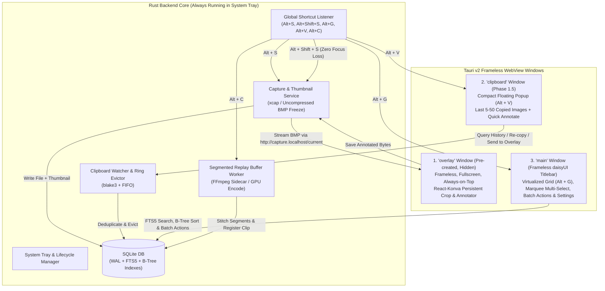
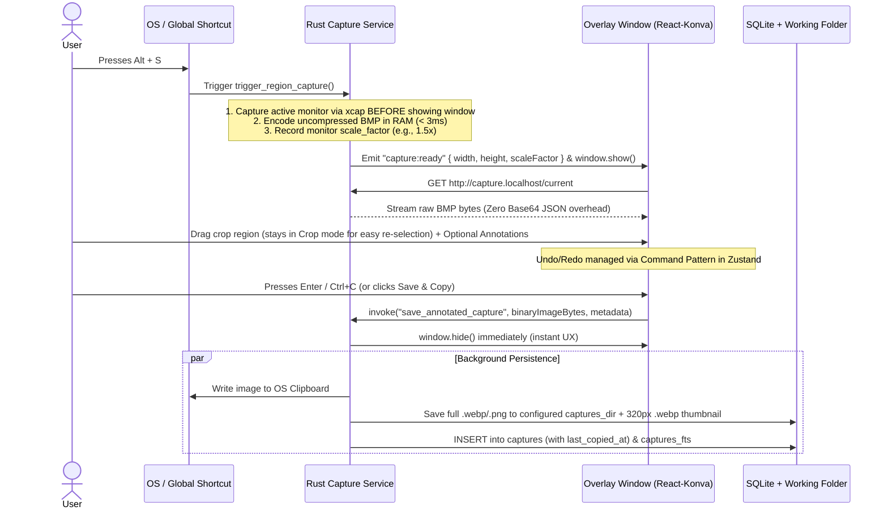
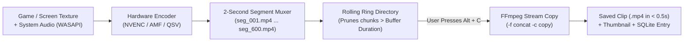

# ReplayViewer — System Architecture Blueprint

> **Goal:** A lightweight, hardware-friendly screenshot, visual clipboard, and rolling video replay desktop application built with **Tauri v2, Rust, SQLite, React, TypeScript, Tailwind CSS v4, and daisyUI v5**—engineered to replace bloated utilities like Windows Xbox Game Bar while maintaining **< 50 MB idle RAM** and **60 FPS gallery scrolling & sorting across 10,000+ captures**.

---

## 1. Architectural Principles & Engineering Highlights

1. **Zero-Base64 Uncompressed BMP Capture Streaming (`http://capture.localhost/current` & `capture://`):**
   Standard JSON serialization of a 4K screenshot (~33 MB raw RGBA / ~5 MB PNG) causes 300–800ms UI freezes, and PNG compression in debug builds takes ~250ms. ReplayViewer freezes the active monitor in RAM as an **uncompressed BMP (`< 3ms` zero-CPU encoding)** and streams it via a custom Tauri URI scheme (`http://capture.localhost/current` on Windows WebView2, `capture://localhost/current` on macOS/Linux WebKit), reducing transfer overhead to near zero.
2. **Pre-Warmed Frameless Windows & Custom daisyUI Titlebar (< 16ms Wakeup):**
   Spawning a new WebView2 window on Windows takes 200–400ms. ReplayViewer initializes a hidden, frameless, transparent `overlay` window at startup and toggles visibility *after* the screen buffer is frozen in Rust. Both the `main` gallery window and `overlay` window run frameless (`decorations: false`) with a custom daisyUI v5 titlebar (`data-tauri-drag-region`) and native window controls (Minimize, Maximize/Restore, Close to Tray).
3. **SQLite WAL Mode + FTS5 Inverted Index + B-Tree Indexed Sorting:**
   All capture metadata, groups/collections, tags, OCR text, `last_copied_at` timestamps, and clipboard history live in a local SQLite database (`AppData/Local/com.replayviewer.app/replay_viewer_v2.db`) running with `PRAGMA journal_mode = WAL;` and `PRAGMA synchronous = NORMAL;`. Full-text search across tags, groups, source apps, and OCR text uses an **FTS5 virtual table** (`< 5ms` query latency), while B-Tree indexes (`idx_captures_created_at`, `idx_captures_size_bytes`, `idx_captures_last_copied`, `idx_captures_group_name`) allow instant forward/reverse sorting (`DESC` ↔ `ASC`) in `< 1ms` even across 50,000+ records.
4. **Disk-Backed Visual Clipboard with `< 1ms` Non-Blocking OS Lock & Hash Deduplication (`Alt + V`):**
   Only the active clipboard image resides in OS RAM. To prevent freezing source applications (like Discord or browsers) when copying 12 MB+ images, Rust waits for a `180ms` clipboard settle window, holds the Windows `OpenClipboard` lock for **< 1ms** (performing only a raw RAM `memcpy` of `"PNG"` or `CF_DIBV5`/`CF_DIB`), and decodes/hashes outside the lock. Historical clipboard images (5–50 slots) are hashed in `< 0.5ms` for instant deduplication, stored on disk, and previewed via 200px thumbnails (~15 KB each).
5. **Single-Instance Loopback Guard & Portable `./captures` Default Storage:**
   On startup, `single_instance.rs` binds a crash-proof loopback `TcpListener` recorded in `%LOCALAPPDATA%\com.replayviewer.app\instance.lock`. Launching `replay-viewer.exe` a second time sends `"FOCUS_MAIN\n"` to the running instance—bringing the existing `main` window to the foreground instead of spawning duplicate processes or tray icons. New installations default to a portable `./captures` folder next to `replay-viewer.exe` (falling back to `Pictures/ReplayViewer/captures` only if installed in a read-only directory).
6. **Smart Storage Quota with 100% Pinned Immunity & 3-Day "Queued Deletion" Grace Buffer (`v1.5.3`):**
   Defaults to a **10 GB** library cap and **No Max Retention Age (`0` = Keep Forever)**. Pinned captures (`is_pinned = 1`) are **never** pruned or counted toward eviction. When unpinned captures exceed the storage cap or optional retention age, they are placed into a **3-day "Queued Deletion" grace period (`queued_delete_at = now + 3 days`)** where users can view the exact countdown & deletion datetime and restore or pin them before permanent disk removal.
7. **Hybrid Segmented Ring Buffer for 30s–20m Replays (`Alt + C`):**
   Instead of holding 4 GB of video in RAM for a 20-minute replay, the replay engine encodes 2-second hardware-accelerated segments (NVENC / AMF / QuickSync / VideoToolbox) into a rolling ring directory and executes a lossless stream copy (`ffmpeg -f concat -c copy`) in **< 0.5 seconds** on save. Uses `Alt + C` ("Save Clip") by default to avoid colliding with NVIDIA's `Alt + R` performance overlay.

---

## 2. Technology Stack

### Frontend (`src/`)
| Layer | Technology | Purpose |
| :--- | :--- | :--- |
| **UI Framework** | React 19 + TypeScript (Strict) | Component architecture for Frameless Gallery, Overlay, and Clipboard Drawer |
| **Build Tool** | Vite 6 + `@tailwindcss/vite` | Fast HMR and optimized static asset bundling for Tauri |
| **Styling & Themes** | Tailwind CSS v4 + **daisyUI v5** + Lucide Icons | Semantic UI components (`navbar`, `card`, `modal`, `tabs`, `join`, `badge`, `toast`) with 10 live-switchable themes (`night`, `dark`, `dracula`, `synthwave`, `cyberpunk`, `nord`, etc.) |
| **Canvas & Annotations** | `konva` + `react-konva` | Hardware-accelerated HTML5 2D canvas for persistent region crop, arrows, text, freehand pen, and destructive pixelate redaction |
| **State Management** | Zustand | Lightweight stores for editor tool state, Command-pattern Undo/Redo stack, multi-selection, and gallery filters/sorting |
| **Virtualization** | `@tanstack/react-virtual` | Windowed grid rendering + dynamic 1–8 column card resizer + O(N) math rubber-band marquee multi-selection |

### Desktop & Backend (`src-tauri/`)
| Layer | Crate / Plugin | Purpose |
| :--- | :--- | :--- |
| **Core Framework** | `tauri` (`v2.12`) | Frameless multi-window lifecycle, System Tray, Custom URI Protocols (`capture://`), IPC |
| **Shortcuts & Clipboard** | `tauri-plugin-global-shortcut` (`v2.4`), `tauri-plugin-clipboard-manager` (`v2.5`) | Global hotkeys (`Alt+S`, `Alt+Shift+S`, `Alt+G`, `Alt+V`, `Alt+C`) and native clipboard writes |
| **Screen Capture (v1.0)** | `xcap` + `image` | Cross-platform monitor pixel capture, `< 3ms` uncompressed BMP freeze buffer, direct RGBA-to-WebP persistence, and 320px WebP thumbnails |
| **Database** | `rusqlite` (`v0.32`, `bundled`) | Embedded SQLite engine with WAL mode, FTS5 full-text search, and B-Tree sorting indexes |
| **Clipboard Watcher (v1.5)** | `arboard` + `clipboard-master` + `blake3` | Event-driven OS clipboard listener and sub-millisecond pixel hash deduplication |
| **Local Native OCR (v1.5)** | `Windows.Media.Ocr` (WinRT) / macOS `Vision` (`ocrs` fallback) | Zero-bloat (`0 MB` installer & `0 MB` idle RAM) background text extraction indexed into `captures_fts` |
| **Replay Engine (v2.0)** | `windows-capture` / OS backends + FFmpeg Sidecar | GPU texture capture, WASAPI loopback audio, and hardware-encoded segmented ring buffer |
| **Semantic Visual AI (v2.0.5)** | Opt-in `ort` / `tract-onnx` (`MobileCLIP` / `CLIP-INT8`) | On-demand 512-d vector embeddings (`1 KB`/img) + 60s lazy RAM unloader + `< 8ms` SIMD visual search |

---

## 3. Multi-Window Process Architecture



### Window Lifecycle Strategy
1. **`overlay` Window (`Alt + S`):** Initialized on app launch with `visible: false`, `decorations: false`, `transparent: true`, `always_on_top: true`. Starts with **no region pre-selected (`cropRect: null`)** and **stays in region capture mode** after dragging a selection so users can immediately re-adjust or re-drag their crop box until they choose an annotation tool or press `Enter` / `Ctrl + C`.
2. **`clipboard` Window (`Alt + V` — Phase 1.5):** Compact (`380x520`), frameless popup positioned near the cursor or screen corner. Auto-hides on blur (`on_focus_changed`) or `Escape`.
3. **`main` Window (`Alt + G`):** Frameless window (`decorations: false`) with an integrated daisyUI v5 draggable titlebar (`Minimize`, `Maximize/Restore`, `Close to Tray`). Houses the Virtualized Gallery, Marquee Multi-Selection & Batch Action Bar, and Settings. Closing the window hides it to the System Tray without terminating the background hotkey listener.

---

## 4. Core Data Pipelines

### 4.1 Phase 1: Screenshot, DPI Normalization & Annotation Flow (`Alt + S` & `Alt + Shift + S`)



### 4.2 Gallery B-Tree Sorting, Marquee Multi-Selection, Batch Operations & Working Folder Lifecycle

1. **Zero-Lag Sorting Across 10,000+ Items:**
   * Rather than sorting arrays in JavaScript on the UI thread, ReplayViewer delegates sorting to SQLite B-Tree indexes (`idx_captures_created_at`, `idx_captures_size_bytes`, `idx_captures_last_copied`).
   * Reversing sort order (`DESC ↓` ↔ `ASC ↑`) simply walks the SQLite B-Tree index in reverse order ($O(\log N)$ seek, `< 1ms`) while `@tanstack/react-virtual` mounts only the ~15–25 visible DOM cards on screen.
2. **Rubber-Band Marquee Drag-to-Select (Even Starting on Child Cards):**
   * Cards and thumbnails disable native HTML5 ghost-image dragging (`draggable={false}`).
   * Holding left-click and dragging `>= 6px` anywhere in the gallery (even starting directly on an image card) activates a translucent daisyUI marquee selection box, auto-scrolls near viewport edges, and computes intersecting grid cells across virtualized rows in $O(N)$ pure coordinate math.
3. **Batch Multi-Selection Actions:**
   * **Group Selected (`batch_set_group`):** Assigns a custom `group_name` (collection/album) to all selected captures in a single SQLite transaction and indexes the group name in `captures_fts`.
   * **Add Tags (`batch_add_tags`):** Attaches comma-separated `#tags` to all selected captures in one transaction.
   * **Move to External Folder (`move_captures_to_folder`):** Uses a native OS Folder Picker dialog (`pick_folder_dialog`) to move selected image/video files out of the working directory into a target folder on disk, cleans up their `.webp` thumbnails, and deletes their rows from the working gallery database.
   * **Delete Selected (`delete_captures`):** Removes all selected files, thumbnails, and SQLite/FTS5 records.
4. **Working Directory Change Flow & Pre-Existing Media Import (`migrate_captures_to_folder`, `scan_unindexed_media`, `import_external_media`):**
   * **Active Folder Scoping:** `list_captures` scopes queries to the currently active `captures_dir`.
   * **Move vs. Switch View Prompt:** When changing the Storage Directory in Settings, the user is prompted to either **Move Existing Captures to New Folder** (migrating files & `.thumbs` on disk and updating SQLite paths so all tags, pins, and groups stay intact) or **Switch Active Folder View** (keeping the old folder's files untouched on disk and remembering their SQLite metadata if the user ever switches back).
   * **Pre-Existing Media Discovery Prompt:** Whenever switching to a folder (or clicking **Sync DB** in the Gallery), Rust scans top-level media files (`.webp`, `.png`, `.jpg`, `.jpeg`, `.bmp`) in the active folder. If unindexed files are found, a confirmation modal (*"Found X existing image(s) in Folder — Import into Gallery?"*) lets the user import them with original file modification dates preserved and fast `320px` WebP thumbnails generated.

---

### 4.3 Phase 1.5.1: Visual Image Clipboard Flow, `< 1ms` Non-Blocking Lock, Non-Destructive Vector Layers & Visual Zoom (`Alt + V`)

1. **Zero-Stutter `< 1ms` Non-Blocking OS Clipboard Watcher:**
   * On Windows, Rust checks `clipboard_win::raw::seq_num()` (`GetClipboardSequenceNumber()`, ~20ns atomic read that does not open or lock the clipboard) and respects Windows clipboard privacy flags (`ExcludeClipboardContentFromMonitorProcessing`).
   * When a new sequence number is detected, Rust waits `180ms` (`wait_for_clipboard_settle`) so multi-format writers like Discord/Chromium finish writing all clipboard formats without lock contention.
   * Rust then opens `OpenClipboard` for **< 1ms** solely to `memcpy` raw `"PNG"` bytes (or `CF_DIBV5`/`CF_DIB` bytes) into a Rust `Vec<u8>`, immediately closes `OpenClipboard`, and performs all image decoding, hashing, and disk persistence outside the OS lock.
2. **Sub-Millisecond Pixel Digest & Fast Persistence:**
   * Computes a collision-resistant digest over `(width, height, raw_rgba_bytes)` using hardware-accelerated SIMD `crc32fast` (full buffer, ~0.3ms for 1080p) + `Sha256` (`< 0.5ms` total).
   * If `blake3_hash` already exists in `clipboard_history`, updates `copied_at` and marks it `CURRENTLY COPIED` (`active_clipboard_hash`) without duplicating files on disk.
   * If new, writes raw `"PNG"` bytes directly to `app_data/clipboard_cache/` (`< 2ms`, zero re-encoding) or uses fast PNG compression (`CompressionType::Fast`, ~60ms) for `> 1080p` images, plus a `200px` `.webp` thumbnail (`FilterType::Triangle`).
3. **Pinned-on-Top Ordering & FIFO Ring Eviction:**
   * Queries return `ORDER BY is_pinned DESC, copied_at DESC` so pinned items stay anchored at the top while unpinned items flow underneath.
   * Enforces `settings.clipboard_max_items` (`5`, `10`, `20`, or `50` unpinned items), deleting both SQLite rows and `.webp` files for evicted unpinned items.
   * Remembers the user's window Always-on-Top toggle (`clipboard_always_on_top`) across `Alt + V` sessions.
4. **1:1 Centered Annotation, Visual Zoom vs. Output Resize Lock, & Cross-Session `Ctrl + Z` / `Ctrl + Y`:**
   * Clicking **Annotate (`A`)** on any clipboard item loads its clean `base_file_path` into the `overlay` window centered at its **1:1 actual pixel dimensions**, with `cropRect` pre-selected to the image bounds.
   * **Visual Zoom by Default (`Output Locked`):** Zooming via `1:1`, `2×`, `4×`, `Fit`, or dragging the 4 corner handles magnifies the canvas for editing while exporting with `pixelRatio = origWidth / displayWidth` so a `100×100` image zoomed to `400%` still saves at `100×100` (with a 1-click **`Output: Locked` ↔ `Resize Output`** toggle pill if the user wants to save the scaled dimensions).
   * **Cross-Session `Ctrl + Z` / `Ctrl + Y` Vector History (`0 MB` Idle RAM):** On save, non-destructive vector shapes (`Arrow`, `Rect`, `Pen`, `Text`) are normalized to canonical `(0..outputW, 0..outputH)` coordinates and stored in `clipboard_history.annotations_json` (~1–2 KB), while a clean `base_file_path` (with only destructive `Pixelate` redactions baked in for security) is saved alongside the flattened `.webp`. Re-opening the item in the annotator hydrates the saved shapes into Zustand's Undo stack (`past`) so `Ctrl + Z` and `Ctrl + Y` work across sessions.

---

### 4.4 Phase 2.0: Segmented Hardware Replay Buffer (`Alt + C`)



* **Why Segmented Chunks Beat a Raw RAM Buffer:**
  A 20-minute 1080p60 capture at 25 Mbps is ~3.75 GB. Writing 2-second fragmented segments (`.ts` or `.mp4`) into a dedicated temp ring folder keeps **app RAM usage under 50 MB** regardless of whether the buffer is 30 seconds or 20 minutes.
* **Zero Re-Encoding on Save:** Because segments are already hardware-encoded on the fly, pressing `Alt + C` only concatenates container packets (`-c copy`), finishing almost instantaneously.
* **MIT-Safe On-Demand FFmpeg Distribution (~5 MB Base Installer):**
  To keep the base Tauri installer tiny (~5–7 MB) and 100% compliant with the project's **MIT License**, FFmpeg is not statically bundled inside the base installer. In Phase 2.0, ReplayViewer checks the system `PATH` for an existing `ffmpeg` binary, offers a one-click **"Download Replay Engine (Minimal LGPL Build)"** in Settings (`AppData/Local/ReplayViewer/bin/`), and allows power users to point to a custom Full GPL (`libx264`) FFmpeg binary path if desired.

---

### 4.5 Phase 1.5.3, 1.5.4 & 2.0.5: Smart Storage 3-Day Grace Buffer, Native OS OCR & Opt-In CLIP Semantic Visual Search

1. **Automated Storage Quota, 100% Pinned Immunity & 3-Day "Queued Deletion" Grace Period (`v1.5.3`):**
   * **Defaults:** `max_storage_gb = 10` (10 GB cap) and `auto_cleanup_days = 0` (No max retention age / Keep Forever).
   * **Pinned Immunity:** Captures with `is_pinned = 1` are 100% exempt from both storage cap and retention age pruning. Pinning a capture that is currently in `Queued Deletion` immediately clears `queued_delete_at = NULL`.
   * **Two-Stage 3-Day Grace Period (`queued_delete_at`):**
     1. **Stage 1 (Soft Queue):** When unpinned active captures exceed `max_storage_gb` or `auto_cleanup_days`, the oldest unpinned captures are marked with `queued_delete_at = Utc::now() + Duration::days(3)`. They remain on disk and move into the Gallery's **`Queued Deletion (X)`** filter tab, displaying a live countdown (`"2d 23h left • Deletes Nov 18, 20:35"`) and 1-click **Restore** / **Pin & Restore** actions.
     2. **Stage 2 (Permanent Purge):** Only after `queued_delete_at <= Utc::now()` (3 full days in the buffer without being restored or pinned) does the background cleanup runner delete the `.webp`/`.png`/`.mp4` file, thumbnail, and SQLite/FTS5 rows.
2. **Zero-Bloat Native OS Background OCR (`v1.5.4`):**
   * Instead of bundling a 50+ MB OCR runtime in the installer, Rust implements a cross-platform `OcrProvider` trait (`src-tauri/src/services/ocr.rs`) that invokes the operating system's built-in hardware-accelerated OCR API:
     * **Windows 10/11:** WinRT `Windows::Media::Ocr::OcrEngine::TryCreateFromUserProfileLanguages()` + `SoftwareBitmap::CreateCopyFromBuffer` (`BGRA8` decoded in Rust so `.webp` works even without the Microsoft Store WebP WIC codec).
     * **macOS:** Apple Vision framework (`VNRecognizeTextRequest`).
     * **Linux:** Local `ocrs` / `tesseract` CLI fallback if installed.
   * Tracks `ocr_status` (`'pending' | 'done' | 'failed'`) in SQLite so textless images are never re-scanned infinitely, and indexes extracted text into `captures.ocr_text` and `captures_fts` for **`< 2 ms`** text queries across 10,000+ captures.
3. **Opt-In Semantic AI Visual Search (`v2.0.5` — Finding `"cat"` in 10,000 Unlabeled Images):**
   * **On-Demand Model Download (`0 MB` Base Installer Bloat):** Users who want semantic visual search can toggle *"Enable Smart AI Visual Search (~95 MB Download)"* in Settings, which downloads a quantized INT8 `MobileCLIP` / `CLIP-ViT-B32` ONNX model into `AppData/Local/com.replayviewer.app/models/`.
   * **One-Time Thumbnail Embedding (`1 KB` per Image):** When a capture is saved, the vision encoder processes its `320px` thumbnail once (~40–80 ms) and stores a 512-dimensional quantized vector (`512 bytes–1 KB`) in SQLite (`capture_embeddings` — only `10 MB` for 10,000 images).
   * **60-Second Lazy RAM Unloader (`0 MB` Idle Bloat):** The ONNX runtime session is automatically dropped from RAM after 60 seconds of inactivity so background tray RAM stays `< 50 MB`.
   * **Sub-8ms Search Across 10,000+ Images:** Typing a natural-language concept (e.g., `"cat"`, `"sunset"`, `"scoreboard"`, `"red car"`) encodes the query text (~3 ms) and computes SIMD cosine similarity across 10,000 SQLite image vectors in **~2–4 ms** in Rust.

---

## 5. SQLite Database Schema (`src-tauri/src/db/mod.rs`)

```sql
PRAGMA journal_mode = WAL;
PRAGMA synchronous = NORMAL;
PRAGMA foreign_keys = ON;

-- 1. Main Captures Table (Screenshots & Video Replays)
CREATE TABLE IF NOT EXISTS captures (
    id              TEXT PRIMARY KEY,               -- UUID v4
    media_type      TEXT NOT NULL CHECK (media_type IN ('screenshot', 'video')),
    file_path       TEXT NOT NULL,                  -- Absolute path to .webp / .png / .mp4
    thumb_path      TEXT NOT NULL,                  -- Absolute path to 320px .webp thumbnail
    width           INTEGER NOT NULL,
    height          INTEGER NOT NULL,
    size_bytes      INTEGER NOT NULL,
    duration_ms     INTEGER DEFAULT NULL,           -- NULL for screenshots, duration for videos
    source_app      TEXT DEFAULT NULL,              -- Window title / capture source
    ocr_text        TEXT DEFAULT '',                -- Indexed text inside image
    ocr_status      TEXT NOT NULL DEFAULT 'pending',-- 'pending' | 'done' | 'failed'
    is_pinned       INTEGER NOT NULL DEFAULT 0,     -- 1 = 100% exempt from auto-cleanup rules
    group_name      TEXT NOT NULL DEFAULT '',       -- User-assigned Group / Collection name
    last_copied_at  TEXT DEFAULT NULL,              -- ISO timestamp when last copied to OS clipboard
    queued_delete_at TEXT DEFAULT NULL,             -- ISO timestamp when 3-day grace period expires (NULL = active)
    created_at      TEXT NOT NULL DEFAULT (strftime('%Y-%m-%dT%H:%M:%fZ', 'now'))
);

CREATE INDEX IF NOT EXISTS idx_captures_created_at ON captures(created_at DESC);
CREATE INDEX IF NOT EXISTS idx_captures_size_bytes ON captures(size_bytes DESC);
CREATE INDEX IF NOT EXISTS idx_captures_last_copied ON captures(last_copied_at DESC);
CREATE INDEX IF NOT EXISTS idx_captures_group_name ON captures(group_name);
CREATE INDEX IF NOT EXISTS idx_captures_type_pinned ON captures(media_type, is_pinned);
CREATE INDEX IF NOT EXISTS idx_captures_queued_delete ON captures(queued_delete_at);

-- 2. Tags & Many-to-Many Join Table
CREATE TABLE IF NOT EXISTS tags (
    id              INTEGER PRIMARY KEY AUTOINCREMENT,
    name            TEXT NOT NULL UNIQUE COLLATE NOCASE,
    color           TEXT NOT NULL DEFAULT '#3b82f6'
);

CREATE TABLE IF NOT EXISTS capture_tags (
    capture_id      TEXT NOT NULL REFERENCES captures(id) ON DELETE CASCADE,
    tag_id          INTEGER NOT NULL REFERENCES tags(id) ON DELETE CASCADE,
    PRIMARY KEY (capture_id, tag_id)
);

-- 3. FTS5 Virtual Table for Sub-5ms Search (Source App, OCR Text, Tags & Group Name)
CREATE VIRTUAL TABLE IF NOT EXISTS captures_fts USING fts5(
    capture_id UNINDEXED,
    source_app,
    ocr_text,
    tag_names,
    tokenize = 'porter unicode61'
);

-- 4. Phase 1.5.1 Visual Clipboard History Ring (Alt + V)
CREATE TABLE IF NOT EXISTS clipboard_history (
    id                  TEXT PRIMARY KEY,
    blake3_hash         TEXT NOT NULL UNIQUE,           -- Prevents duplicate entries on repeated Ctrl+C
    file_path           TEXT NOT NULL,                  -- Flattened .webp image
    thumb_path          TEXT NOT NULL,                  -- 200px .webp thumbnail
    base_file_path      TEXT DEFAULT NULL,              -- Clean base .webp (only Pixelate redactions baked in)
    annotations_json    TEXT NOT NULL DEFAULT '[]',     -- Vector shapes for cross-session Ctrl+Z / Ctrl+Y
    width               INTEGER NOT NULL,
    height              INTEGER NOT NULL,
    size_bytes          INTEGER NOT NULL,
    is_pinned           INTEGER NOT NULL DEFAULT 0,
    copied_at           TEXT NOT NULL DEFAULT (strftime('%Y-%m-%dT%H:%M:%fZ', 'now'))
);

CREATE INDEX IF NOT EXISTS idx_clipboard_copied_at ON clipboard_history(is_pinned DESC, copied_at DESC);

-- 5. User Settings, Keybinds & Working Storage Directory
CREATE TABLE IF NOT EXISTS settings (
    key             TEXT PRIMARY KEY,
    value           TEXT NOT NULL,                  -- JSON-encoded value (includes custom captures_dir)
    updated_at      TEXT NOT NULL DEFAULT (strftime('%Y-%m-%dT%H:%M:%fZ', 'now'))
);
```

---

## 6. Cross-Platform Rust Trait Abstractions & Mobile Sandbox Architecture

To support **Windows, macOS, and Linux** cleanly now—and prepare for **Android and iOS** post-2027—all OS-specific logic is isolated behind Rust traits (`ScreenCaptureProvider`, `ReplayBufferProvider`).

### 6.1 Desktop vs. Mobile OS Sandbox Constraints (Phase 3.0 Design)

| Capability | Desktop (Win / Mac / Linux) | Android (`v3.0`) | iOS (`v3.0`) |
| :--- | :--- | :--- | :--- |
| **Screenshot Trigger** | Global Hotkey (`Alt + S`) freezes screen before overlay | **Quick Settings Tile**, **Floating Assist Bubble**, or **Default Assistant Gesture** | **Action Button / Back-Tap Apple Shortcut** & **iOS Share Sheet Extension** |
| **30s–20m Replay Buffer** | Always-on Background Ring (`Alt + C`) via NVENC/AMF/QSV | **On-Demand "Gaming Mode"** (`MediaProjection` Foreground Service + `AudioPlaybackCapture`) | **Not Always-On** (iOS acts primarily as a **PC Clip Receiver & Trimmer**) |
| **Visual Image Clipboard** | Event-driven OS Listener (`Alt + V`) | Floating Overlay Paste Drawer / Share Target | In-App & Share Extension Image Stash |
| **Smart Gallery, OCR & Auto-Cleanup** | Local SQLite + FTS5 + Folder Quota Engine | Local SQLite + FTS5 + Auto-clean `Pictures/Screenshots/` | **Camera Roll De-Clutterer** (`PHPhotoLibrary` observer + OCR/FTS5) |
| **Cross-Device Sync** | LAN Host / Sender (mDNS + QUIC/WebRTC) | LAN Peer (Send & Receive clips/screenshots) | LAN Peer (Instant PC-to-iPhone gaming clip transfer) |

---

## 7. Security, Gaming & Data Integrity Guarantees

### 7.1 Phase 1.0 (`v1.0`) Guarantees: Anti-Cheat Safety, Fullscreen Focus & DB Integrity
1. **100% Anti-Cheat Safe Capture (Zero DLL Injection):**
   ReplayViewer captures frames exclusively via OS-sanctioned desktop compositor APIs (`xcap` / Desktop Duplication / `Windows.Graphics.Capture`, macOS `ScreenCaptureKit`, Linux `PipeWire`).
2. **Exclusive Fullscreen Accessibility (`Alt + Shift + S`):**
   Alongside `Alt + S` (Region Overlay), ReplayViewer provides **`Alt + Shift + S` (Instant Fullscreen Capture)**—which grabs raw RGBA monitor pixels, writes directly to the OS clipboard, and encodes WebP + thumbnail without opening any window or stealing mouse focus.
3. **Orphaned Database Row Reconciliation:**
   On gallery startup and via the **"Sync DB"** toolbar button, Rust reconciles SQLite records against disk paths and automatically prunes orphaned rows (`captures` and `captures_fts`) whose underlying files were manually deleted or moved in Windows Explorer / Finder.

### 7.2 Phase 2.0 (`v2.0`) Guarantees: Password Manager Privacy & Destructive Redaction
1. **Password Manager & Clipboard Privacy Protection (`Alt + V`):**
   * Inspects native privacy clipboard formats (`ExcludeClipboardContentFromMonitorProcessing` and `CanIncludeInClipboardHistory` on Windows) so sensitive copies from **1Password, Bitwarden, KeePass**, and private browser windows are ignored automatically.
2. **True Destructive Redaction (Before Disk & Before OCR):**
   * Pixelate boxes drawn over sensitive data in `react-konva` are **destructively flattened into a single rasterized bitmap** *before* writing the `.webp`/`.png` file to disk and *before* OCR runs.

---

## 8. Tauri IPC Contract (`invoke` Commands)

| Command | Phase | Arguments | Return Type | Description |
| :--- | :---: | :--- | :--- | :--- |
| `trigger_region_capture` | 1.0 | *None* | `CaptureSessionMeta` | Freezes active screen as uncompressed BMP (`< 3ms`) and opens `overlay` (`Alt + S`) |
| `trigger_fullscreen_capture` | 1.0 | *None* | `CaptureRecord` | Captures fullscreen, copies to clipboard & saves silently without focus loss (`Alt + Shift + S`) |
| `save_annotated_capture` | 1.0 | `image_bytes, copy_to_clipboard, image_format, source_app` | `CaptureRecord` | Flattens cropped/annotated bitmap, generates WebP thumb, copies to clipboard |
| `list_captures` | 1.0 | `cursor, limit, filter: GalleryFilter` | `PaginatedCaptures` | B-Tree sorted (`DESC`/`ASC`), FTS5-filtered query returning items, totals, and distinct groups |
| `toggle_pin_capture` | 1.0 | `id: String, pinned: bool` | `()` | Toggles `is_pinned` status on a capture |
| `add_tag_to_capture` | 1.0 | `capture_id: String, tag_name: String` | `CaptureRecord` | Adds a single searchable FTS5 tag to a capture |
| `batch_add_tags` | 1.0 | `capture_ids: Vec<String>, tag_names: Vec<String>` | `usize` | Adds multiple tags to marquee-selected captures in one transaction |
| `batch_set_group` | 1.0 | `capture_ids: Vec<String>, group_name: String` | `usize` | Assigns a collection/group name to marquee-selected captures |
| `move_captures_to_folder` | 1.0 | `capture_ids: Vec<String>, target_dir: String` | `usize` | Moves selected files to an external folder on disk and removes them from the working gallery DB |
| `migrate_captures_to_folder` | 1.0 | `old_dir: String, new_dir: String` | `usize` | Moves all captures & `.thumbs` from old working folder to new working folder while preserving SQLite tags/pins/groups |
| `scan_unindexed_media` | 1.0 | *None* | `UnindexedScanResult` | Scans active working folder for pre-existing `.webp`/`.png`/`.jpg`/`.bmp` files not yet in SQLite |
| `import_external_media` | 1.0 | *None* | `usize` | Imports unindexed files in active folder with original file modification dates & generates 320px WebP thumbnails |
| `delete_captures` | 1.0 | `ids: Vec<String>` | `usize` | Removes DB records + deletes image/video & thumbnail files from disk |
| `reconcile_orphaned_captures`| 1.0 | *None* | `usize` | Prunes SQLite rows whose underlying media files were deleted in Explorer/Finder |
| `copy_capture_to_clipboard` | 1.0 | `file_path: String` | `()` | Copies image to OS clipboard and updates `last_copied_at` timestamp |
| `pick_folder_dialog` | 1.0 | `default_path: Option<String>` | `Option<String>` | Opens native OS Folder Picker dialog (for changing working folder or moving items) |
| `open_in_file_explorer` | 1.0 | `path: String` | `()` | Opens file (highlighted) or folder in Windows Explorer / macOS Finder / Linux `xdg-open` |
| `seed_benchmark_captures` | 1.0 | `count: u32` | `usize` | Inserts 500+ real WebP-backed benchmark captures in a single SQLite transaction |
| `get_settings` / `update_settings` | 1.0 | `SettingsPayload` | `SettingsPayload` | Reads/updates hotkeys, working `captures_dir`, image format, and storage limits |
| `toggle_clipboard_drawer` | 1.5.1 | *None* | `bool` | Shows/hides the frameless `Alt + V` clipboard window using persisted `clipboard_always_on_top` |
| `get_clipboard_always_on_top` / `set_clipboard_always_on_top` | 1.5.1 | `always_on_top: bool` | `bool` | Reads/persists the user's Always-on-Top window pin choice across `Alt + V` openings |
| `list_clipboard_history` | 1.5.1 | *None* | `Vec<ClipboardItem>` | Returns `Alt + V` items (`ORDER BY is_pinned DESC, copied_at DESC`) with `is_currently_copied` |
| `paste_clipboard_item` | 1.5.1 | `id: String` | `ClipboardItem` | Writes historical image to OS clipboard, marks `CURRENTLY COPIED`, and closes drawer |
| `annotate_clipboard_item` | 1.5.1 | `id: String` | `CaptureSessionMeta` | Loads clean `base_file_path` + `annotations_json` into 1:1 centered `overlay` annotator |
| `promote_clipboard_to_gallery` | 1.5.1 | `id: String` | `CaptureRecord` | Archives a clipboard item permanently into the Gallery working folder |
| `toggle_pin_clipboard_item` / `delete_clipboard_item` / `clear_unpinned_clipboard_history` | 1.5.1 | `id, pinned` | `()` / `usize` | Pins items to top (exempt from FIFO eviction), deletes single item, or clears unpinned items |
| `restore_queued_captures` | 1.5.3 | `ids: Vec<String>, also_pin: Option<bool>` | `usize` | Rescues captures from the 3-day `Queued Deletion` grace buffer (`queued_delete_at = NULL`) and optionally pins them |
| `get_storage_status_preview` | 1.5.3 | `max_storage_gb, auto_cleanup_days` | `StorageStatusSummary` | Dry-run storage breakdown (Pinned vs. Unpinned vs. Queued 3-Day Grace) and candidate preview |
| `enforce_storage_policies_now` | 1.5.3 | *None* | `StorageStatusSummary` | Queues over-quota/expired unpinned captures for 3-day deletion and purges captures past their 3-day grace window |
| `run_ocr_backfill_now` | 1.5.4 | *None* | `usize` | Scans pending captures in the active folder using Native OS OCR and indexes text into `captures_fts` |
| `save_replay_buffer` | 2.0 | *None* | `CaptureRecord` | Concatenates rolling video segments into a saved `.mp4` clip (`Alt + C`) |
| `trim_video_clip` | 2.0 | `id, start_ms, end_ms, replace_original` | `CaptureRecord` | Lossless/fast FFmpeg trim of a saved video clip |
| `semantic_visual_search` | 2.0.5 | `query: String, limit: u32` | `Vec<CaptureRecord>` | Ranks unlabeled images via opt-in `CLIP-INT8` 512-d vector cosine similarity in `< 8 ms` |
